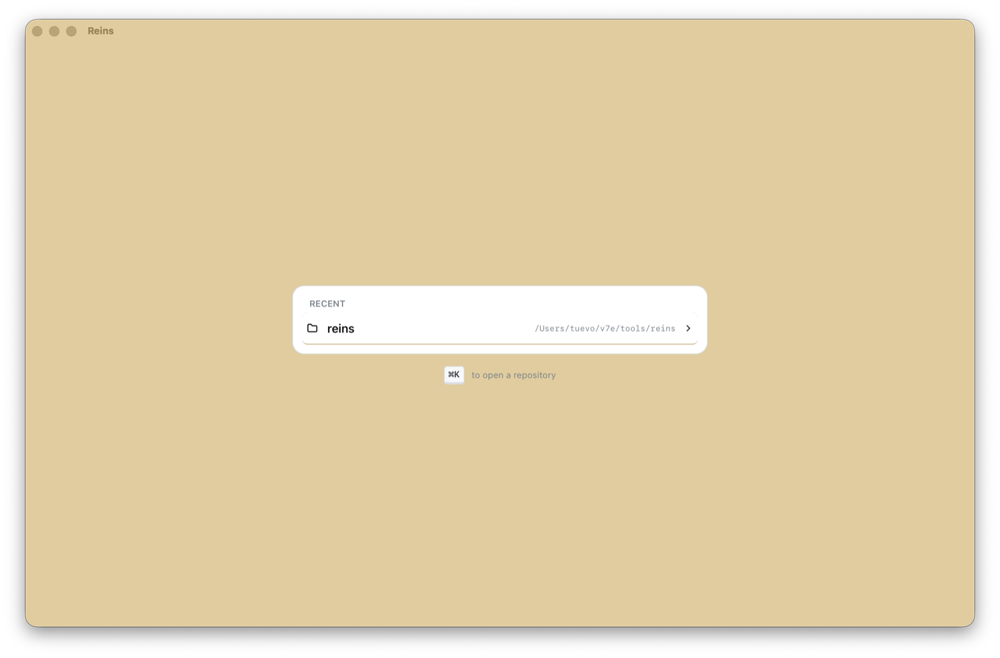
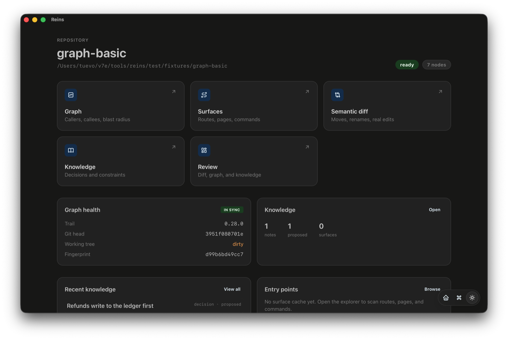
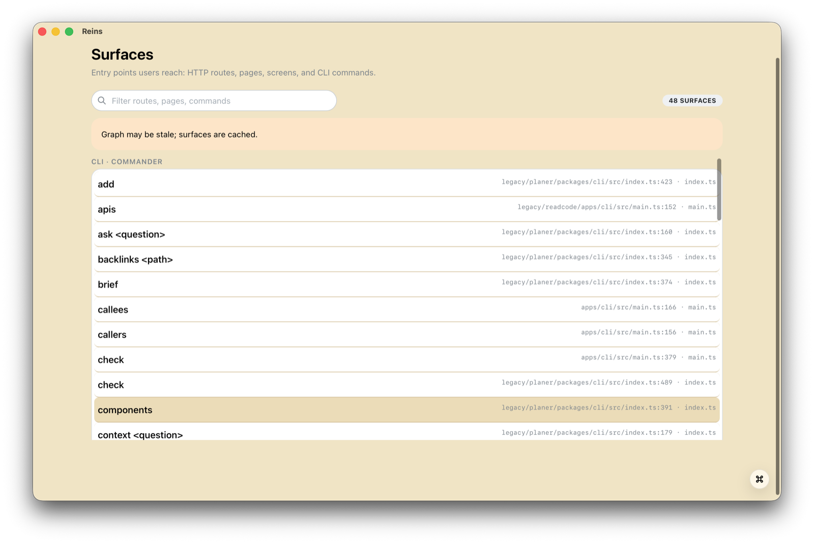
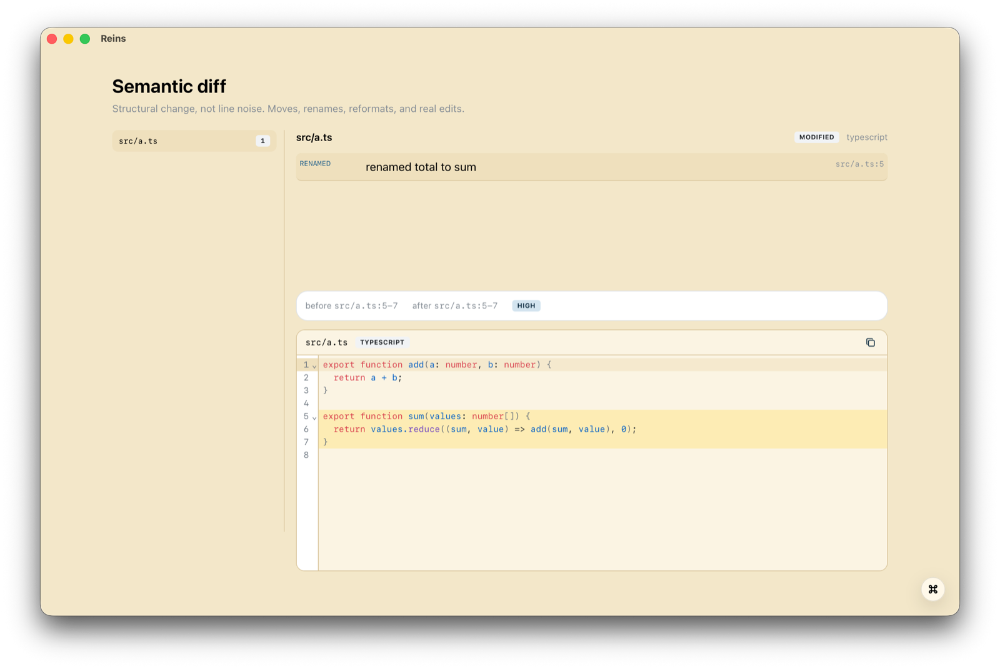

# Reinss

A local-first desktop app and embeddable React component set for three jobs:

1. Read a repository's structure without re-parsing it by hand: symbols, callers, callees, blast radius, and the entry points users actually reach (APIs, pages, screens, CLI commands).
2. Keep the intent next to the code: specs, decisions, constraints, and "how we build here", linked to real symbols and diff ranges.
3. Review change by structure, not by line noise: moved, renamed, extracted, reformatted, and truly edited code, with a machine-readable form for agents.

Reinss is built on [Trail](https://github.com/trailhq) as the code graph. It does not fork or reimplement Trail's parser or storage. It wraps Trail behind one adapter, then adds surfaces, semantic diff, knowledge, and review on top.

**Status: implemented MVP.** The workspace, core, Trail adapter, surface scanners, semantic diff, knowledge ledger, CLI, MCP server, embeddable React components, and Tauri shell exist. Surfaces are grouped by C1 component (webapp, mobile, backoffice, core, cli), can be filtered to the lines a Git range changed, and verify their symbols against the Trail graph. The Git tool shows status, stages and unstages files, commits, reviews a range in one tab, draws history as a Canvas tree, and manages local and remote branches, tags, and worktrees. The desktop uses `Cmd+K` as its only navigation surface. Phase 6 hardening (packaging, Windows/Linux) remains; the file watcher is in. [TODO.md](TODO.md) tracks the gaps against the full product.

## Documents

| File | Answers |
| --- | --- |
| [docs/01-product-spec.md](docs/01-product-spec.md) | What Reinss is, who it serves, and what each release must do. Includes requirement IDs and acceptance criteria. |
| [docs/02-architecture.md](docs/02-architecture.md) | How the pieces fit: process model, packages, ports, API, storage, caching, security, budgets. |
| [docs/03-data-contracts.md](docs/03-data-contracts.md) | The JSON and file contracts: config, symbols, surfaces, semantic diff, knowledge notes, errors, cache, versioning. |
| [docs/04-roadmap.md](docs/04-roadmap.md) | Six phases with scope, exit gates, and what each phase refuses to build. |
| [docs/05-phase-1-foundation.md](docs/05-phase-1-foundation.md) | The detailed build plan for the small-codebase phase: layout, modules, tests, budgets, demo. |
| [docs/06-ai-harness.md](docs/06-ai-harness.md) | The agent layer: AGENTS.md, project skills, MCP tools, context packs, evaluation, approval gates. |
| [docs/07-decisions-and-risks.md](docs/07-decisions-and-risks.md) | Accepted architecture decisions, rejected ideas, open questions, risk register, spikes to run. |
| [AGENTS.md](AGENTS.md) | The rules an agent follows in this repository. |
| [RULES.md](RULES.md) | Package whitelist and performance rules. Read before adding a dependency or a scan. |
| `openspec/` | Project brief, requirements, technical decisions, and change plans. Read first when present. |

## OpenSpec knowledge

Reinss reads [OpenSpec](https://github.com/Fission-AI/OpenSpec) as the project knowledge base. OpenSpec is not only a spec folder. It holds the brief, requirements, technical decisions, and the task plan for every change, so a person or an agent starts there before reading code. This repository keeps its own knowledge base under `openspec/`.

Reinss imports these files read-only and marks them `source: openspec`:

| Path | Note type |
| --- | --- |
| `openspec/config.yaml` | `constraint` |
| `openspec/project.md` | `spec` |
| `openspec/specs/**/spec.md` | `spec` |
| `openspec/changes/**/proposal.md` | `spec` |
| `openspec/changes/**/design.md` | `decision` |
| `openspec/changes/**/tasks.md` | `howto` |
| `openspec/changes/**/specs/**/spec.md` | `spec` |

`reinss spec` lists the files. `reinss notes` includes them, and `reinss pack` includes imported constraints and decisions. Reinss never writes to `openspec/`.

### Initialize in an existing project

1. Install the OpenSpec CLI. It needs Node 22.20 or newer:

   ```bash
   npm install -g @fission-ai/openspec@latest
   ```

2. Initialize at the repository root:

   ```bash
   cd your-project
   openspec init
   ```

   The default installs the workflow skills on your machine. Use `openspec init --scope project` when the skills must be committed with the repository, for example for CI or a hosted agent. Run `openspec update` after upgrading the CLI to refresh them.

3. Move the existing intent into OpenSpec. Start with what the project already knows:

   - `openspec/config.yaml`: project context, commands, and constraints that every change must follow.
   - `openspec/specs/<capability>/spec.md`: current behavior. One requirement per behavior, each with a scenario.
   - `openspec/changes/<change>/proposal.md`: why the change exists and what it changes.
   - `openspec/changes/<change>/design.md`: technical decisions, alternatives, and consequences.
   - `openspec/changes/<change>/tasks.md`: the implementation checklist.

   Keep the old documents where they are until the OpenSpec files are reviewed. Do not copy a template over a document that already states the fact.

4. Validate the structure:

   ```bash
   openspec validate --all --strict
   ```

5. Confirm Reinss reads it:

   ```bash
   reinss spec
   reinss notes
   ```

### Initialize in a new project

Use the `openspec-init` skill in [.agents/skills/openspec-init/SKILL.md](.agents/skills/openspec-init/SKILL.md). It installs the CLI, runs `openspec init`, writes the first `config.yaml`, seeds the first spec, and verifies that Reinss sees the files.

Without an agent, run the same commands:

```bash
npm install -g @fission-ai/openspec@latest
mkdir my-project && cd my-project
openspec init
```

Then ask the agent to explore the idea and propose the first change. The first change creates the first specs. Later changes update them when archived.

## Phase summary

| Phase | Outcome | Gate in one line |
| --- | --- | --- |
| 0 | Spec and decisions | Done. |
| 1 | Strong codebase and one vertical slice | Done: `pnpm check` green; open a repo, search a symbol, see callers. |
| 2 | Surfaces and graph exploration | Done: Express, Hono, Commander, Next.js, React Router, FastAPI, and OpenAPI JSON detectors; C1 component grouping; Git change overlay; flow view. |
| 3 | Semantic diff | Done: move, rename, reformat, modify, extract, add, remove; Git ranges. |
| 4 | Knowledge ledger | Done: notes, typed links, backlinks, OpenSpec import, `reinss check`. |
| 5 | Review workspace and embed | Done: diff, graph, knowledge in one view; components mount in a host React app. |
| 6 | Hardening and full agent layer | Partial: MCP, harness packs, skills, and the file watcher exist; packaging and Windows/Linux remain. |

The implementation follows the same boundaries the spec set: one Trail adapter, one API, one knowledge source, one diff engine.

## UI









Mantine theme with a warm paper light mode and the original dark/blue mode. The homepage is only recent repositories and `Cmd+K`. No top bar. `Cmd+K` opens the Spotlight palette. The workspace has three tools: Git (changes, review, history tree, branches, tags, worktrees), Surfaces (entry points by component, flow, call graph), and Knowledge (notes, check).

## Product principles

- **Wrap, do not rebuild.** One adapter owns Trail. One diff engine owns AST comparison. One knowledge parser owns markdown. No parallel implementations.
- **Local and deterministic by default.** No network call is required to index, search, graph, diff, or check knowledge. An LLM is an explicit opt-in, never a silent dependency.
- **One API, three transports.** The same operations answer the CLI, the desktop Tauri bridge, and MCP. No transport-specific business logic.
- **Embed-first UI.** Every major view is a React component with an injectable client. `node:*`, Tauri, and filesystem imports stay out of the UI packages.
- **Progressive disclosure.** Structural answers first. Optional prose summaries and LLM suggestions come later and are labeled as suggestions.
- **Small code wins ties.** When two designs solve the same problem, the one with fewer packages, fewer dependencies, and fewer states ships.

## Non-goals

- Hosted service, accounts, sync, or remote storage.
- A general-purpose IDE, text editor, or language server.
- Type inference across a whole program.
- Replacing Git, pack files, or the user's editor.
- Reimplementing Trail's parser, graph storage, or learnings format.
- Multiplayer editing in the first releases.
- Running repository code during indexing or diffing.

## Run

```bash
pnpm install
pnpm build
pnpm dev                 # Tauri app
pnpm test                # 26 unit and integration tests
pnpm typecheck
```

CLI:

```bash
# after publishing
npx @reinss/cli status <repo> --json

# before publishing, run the local package through npx
npx --yes --package ./apps/cli reinss status <repo> --json

# or use the local build directly
pnpm reinss status <repo> --json
./bin/reinss status <repo> --json
```

The same commands work for `init`, `bootstrap`, `search`, `callers`, `callees`, `graph`, `surfaces`, `flow`, `diff`, `notes`, `note`, `propose`, `check`, `pack`, `spec`, and `mcp`. `bootstrap` is the idempotent one-step setup: config, knowledge folders, graph, and surfaces.

Publish the three public packages (`@reinss/core`, `@reinss/node`, `@reinss/cli`):

```bash
pnpm release:dry   # dry run, no changes
pnpm bump          # patch-bump the public packages
pnpm publish:all   # publish to npm
pnpm release       # bump then publish
```

Log in to npm first with `npm login`. `@reinss/cli` is the CLI package. `@reinss/core` and `@reinss/node` are its dependencies. `@reinss/ui` and the desktop app stay private for now.

Desktop: open a repository, then press `Cmd+K` (or `Ctrl+K`). There is no top bar. The Mantine Spotlight palette is the only navigation. Recent tools are saved locally. The center area shows one of three tools at a time: Git, Surfaces, or Knowledge.

The Tauri shell spawns `apps/cli/dist/serve.js` as its sidecar. `pnpm dev` builds it first. If you run the Tauri binary directly, run `pnpm --filter @reinss/cli build` once. Override the path with `REINS_SERVE_SCRIPT=/absolute/path/to/serve.js`.

Embed:

```tsx
import { ReinsProvider, ReviewWorkspace, type ReinsClient } from '@reinss/ui';
import '@reinss/ui/styles.css';

export function Review({ client }: { client: ReinsClient }) {
  return (
    <ReinsProvider client={client}>
      <ReviewWorkspace range={{ mode: 'working' }} />
    </ReinsProvider>
  );
}
```

The host supplies the client. The desktop uses the Tauri invoke client; a web host can supply its own transport. No component imports Tauri or Node.

Requirements: Node 22 or newer, pnpm 10, Trail 0.28 or newer, Git 2.30 or newer. The desktop uses Tauri with the system webview and a Node sidecar. Rust and the Tauri CLI are required for desktop work.

Current machine note: `trail` is installed at `/Users/tuevo/.volta/bin/trail` (0.28.0). The `pnpm` shim resolves to Volta but no pnpm toolchain is installed, so `pnpm --version` fails. The build in this session used `npx pnpm@10` with a local store.

## Reading order

For project intent, read `openspec/` first when it exists, then `01` and `04`. For implementation, read `02` then `03` then `05`. For agent work, read `AGENTS.md` then `06`. `07` records why the design looks this way and what is still unproven.
